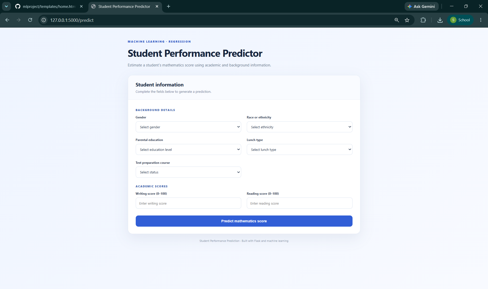
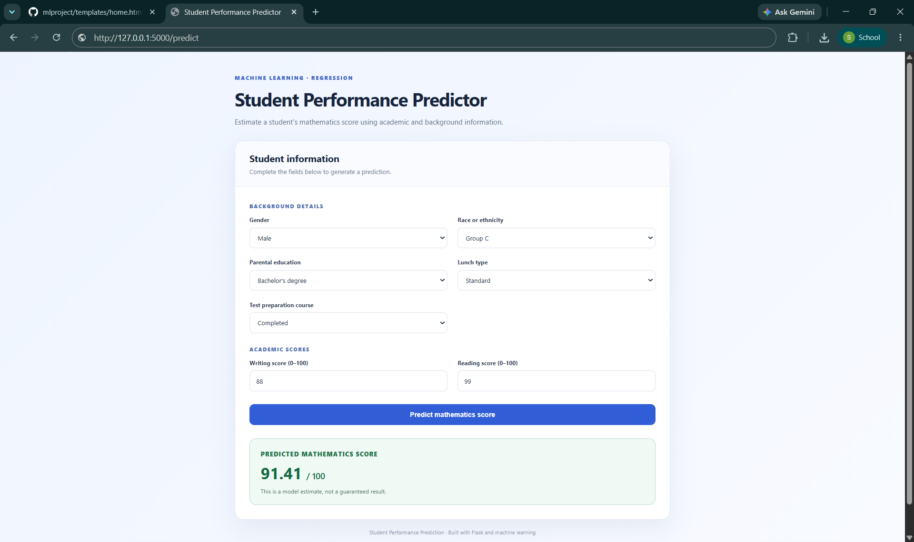
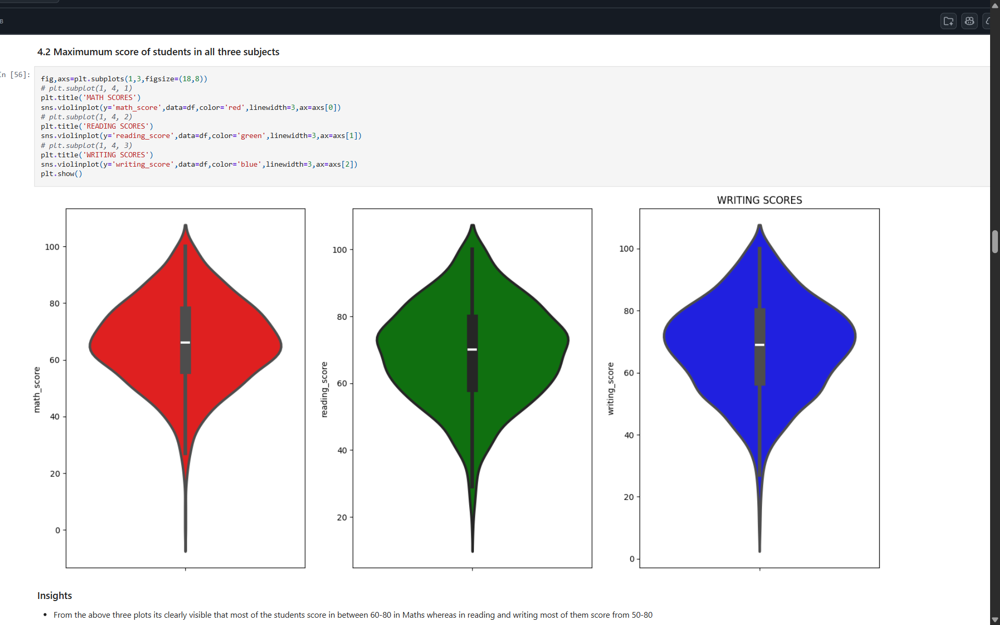
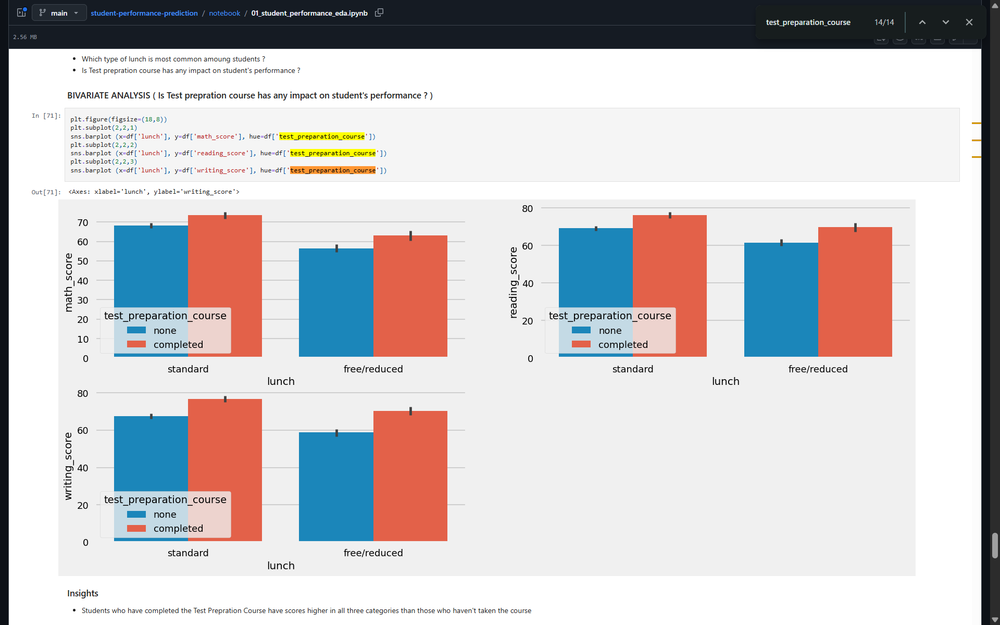
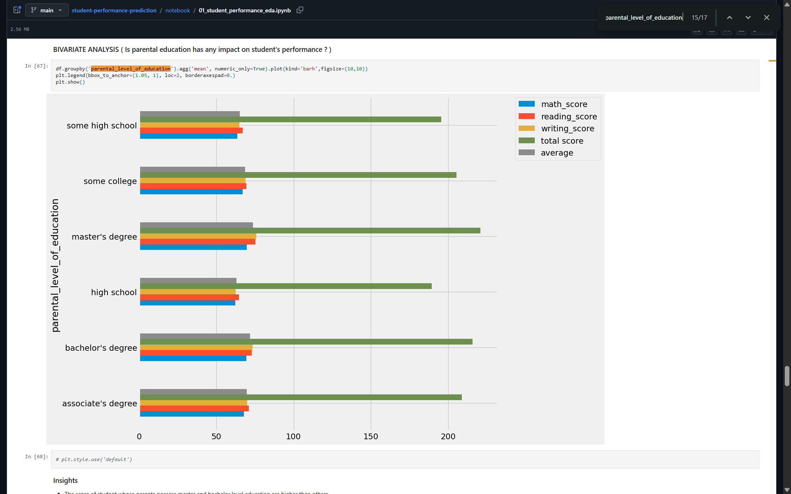

# Student Performance Prediction | End-to-End Machine Learning

An end-to-end machine learning application that estimates a student's **mathematics exam score** using reading and writing scores alongside student background information. The project includes exploratory data analysis, preprocessing, regression model training, and a Flask web interface for interactive predictions.

## Application screenshots

### Student information form


### Mathematics score prediction


## Exploratory Data Analysis

### Score distributions across math, reading, and writing


### Average scores by test preparation status and lunch type


### Average scores by parental education level


## Features

- Predicts a **numeric mathematics score**, rather than a pass/fail category.
- Accepts seven input features through a responsive Flask form.
- Applies the saved preprocessing pipeline to new inputs before prediction.
- Preserves submitted form values when displaying the prediction.
- Separates data ingestion, data transformation, model training, and inference into reusable Python components.

## Input features

| Feature | Description |
| --- | --- |
| `gender` | Student gender |
| `race_ethnicity` | Dataset's group A–E category |
| `parental_level_of_education` | Parent/guardian education category |
| `lunch` | Standard or free/reduced lunch |
| `test_preparation_course` | Completed or none |
| `writing_score` | Writing score (0–100) |
| `reading_score` | Reading score (0–100) |

**Prediction target:** `math_score` (numeric mathematics score).

> Note: Demographic and socioeconomic features are included in the source dataset. Predictions are estimates, not measures of a student's potential, and should not be used for consequential educational decisions.

## Machine learning workflow

1. **Data ingestion:** Read `notebook/data/stud.csv`, split the dataset into training (80%) and testing (20%) sets, and save CSV files under `artifacts/`.
2. **Data transformation:** Impute missing numeric values with the median and standardize numeric scores. For categorical columns, impute the most frequent value, one-hot encode (dropping the first category), and scale.
3. **Model training:** The training code defines seven regression candidates: Linear Regression, Decision Tree, Random Forest, AdaBoost, Gradient Boosting, XGBoost, and CatBoost. It uses grid search and R² scoring to compare candidates.
4. **Prediction:** Flask collects form inputs, the saved `preprocessor.pkl` transforms them, and the saved `model.pkl` predicts the mathematics score.

**Training note:** Model comparison and test-set R² results have yet to be verified.

## Technology stack

**Python**, **Pandas**, **NumPy**, **Scikit-learn**, **XGBoost**, **CatBoost**, **Matplotlib**, **Seaborn**, **Flask**, and **HTML/CSS**.

## Project structure

```text
mlproject/
├── application.py                # Flask application
├── artifacts/                    # Saved data, model and preprocessor
├── notebook/                     # EDA, training notebooks and dataset
├── screenshots/
│   ├── prediction-form.png
│   └── prediction-result.png
├── src/
│   ├── components/
│   │   ├── data_ingestion.py
│   │   ├── data_transformation.py
│   │   └── model_trainer.py
│   ├── pipeline/
│   │   └── predict_pipeline.py
│   ├── exception.py
│   ├── logger.py
│   └── utils.py
├── templates/
│   ├── home.html
│   └── index.html
├── requirements.txt
└── setup.py
```

## Run locally

### 1. Clone the repository

```bash
git clone https://github.com/shammi00/student-performance-prediction.git
cd student-performance-prediction
```

### 2. Create and activate a virtual environment

**Windows:**

```bash
python -m venv venv
venv\Scripts\activate
```

**macOS / Linux:**

```bash
python3 -m venv venv
source venv/bin/activate
```

### 3. Install dependencies

```bash
pip install -r requirements.txt
```

### 4. Start the Flask application

```bash
python application.py
```

Open **http://127.0.0.1:5000/predict** in your browser. Enter the student information and select **Predict mathematics score**.

The application uses the saved files in `artifacts/`, including `model.pkl` and `preprocessor.pkl`.

## Evaluation

The training pipeline uses the **R² (coefficient of determination)** metric for regression evaluation. The example prediction shown in the screenshot is a predicted exam score, **not** an R² score or accuracy percentage.

## Author

**Shammi Kumar Singh** — [GitHub](https://github.com/shammi00)
